# Dépannage d'une VM Windows 10

J'ai récupéré une VM Windows 10 avec plusieurs problèmes dessus. Elle ne démarrait plus du tout, et une fois le démarrage réparé le processeur et la mémoire étaient saturés, un des deux disques n'apparaissait pas dans l'explorateur, et des fichiers manquaient dans le dossier Images de l'utilisatrice.

---

## Le démarrage

Au lancement de la VM, écran noir avec ce message :

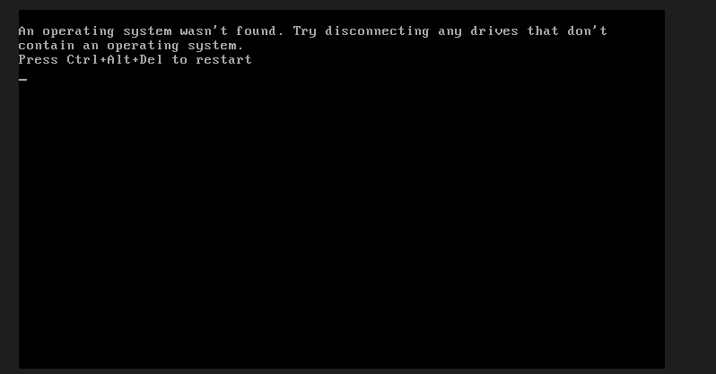

Ce message ne vient pas de Windows mais du firmware, et il parle de disques plutôt que de fichiers, ce qui veut dire qu'il n'a trouvé aucun disque amorçable. Les deux messages dont parle l'énoncé de la VM (`BOOTMGR is missing` et `Winload.exe introuvable`) sont affichés par du code Microsoft déjà chargé en mémoire, donc le problème se situe en amont.

J'ai appuyé sur F12 au lancement pour afficher le menu d'amorçage.

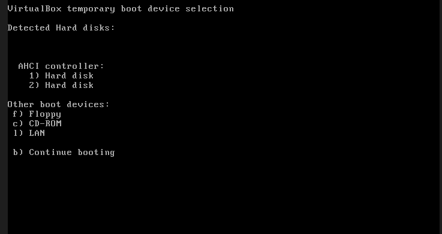

Les deux disques sont détectés, donc le matériel répond et le problème vient de ce qu'ils contiennent. J'ai essayé de démarrer sur chacun des deux, et j'ai eu la même erreur sur l'un et un écran noir sur l'autre.

Comme rien ne démarre, je ne peux pas atteindre l'environnement de récupération installé sur le disque : c'est le bootloader Windows qui compte les démarrages ratés et déclenche la bascule, et il ne se charge jamais. J'ai donc monté un ISO de Windows 10 dans le lecteur optique de la VM pour démarrer dessus, ce qui revient à brancher une clé USB sur une vraie machine. De là, Réparer l'ordinateur, puis Dépannage, puis Invite de commandes.

### Repérer les volumes

Dans l'environnement de réparation, les lettres de lecteur ne correspondent pas à celles du système installé, donc il faut tout revérifier.

```
diskpart
list disk
list volume
```

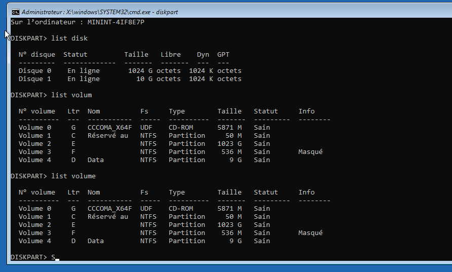

| Disque | Partition | Taille | Lettre (WinPE) | Rôle |
|---|---|---|---|---|
| 0 | 1, active | 50 Mo | C: | Réservé au système |
| 0 | 2 | 1023 Go | E: | Windows |
| 0 | 3 | 536 Mo | F: | Récupération |
| 1 | 1 | 9 Go | D: | Données |

La colonne GPT est vide sur les deux disques, ce qui veut dire qu'ils sont partitionnés en MBR et que la machine démarre en mode BIOS. La chaîne de démarrage passe par le MBR, puis la partition marquée active, puis `bootmgr`, puis `winload.exe`. Sur une machine en UEFI ce serait une partition EFI en FAT32 avec `bootmgfw.efi` et `winload.efi`. Ça a son importance pour la suite, parce qu'il y a deux fichiers `winload` différents dans `System32`.

### Les fichiers manquants

```
dir C:\ /a
```

Le `/a` affiche les fichiers système et masqués, que `dir` seul ne montre pas, et `bootmgr` en fait partie.

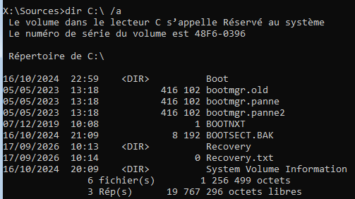

Il y a `bootmgr.old`, `bootmgr.panne` et `bootmgr.panne2`, mais plus aucun fichier au nom attendu.

```
dir E:\Windows\System32\winload* /a
dir E:\Users
```

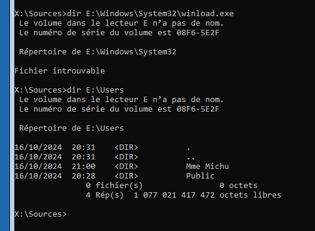

Même chose du côté du chargeur : `winload.panne` est présent et `winload.exe` a disparu. Le `winload.efi` à côté ne sert pas ici puisque la machine démarre en BIOS. Et `E:\Users` contient le profil de Mme Michu, ce qui confirme que E: est bien le volume à réparer.

### Remise en état

Rien n'a été supprimé, tout a été renommé, et les deux noms d'origine étaient donnés par les messages d'erreur eux-mêmes.

```
ren C:\bootmgr.panne bootmgr
ren E:\Windows\System32\winload.panne winload.exe
```

J'ai retiré l'ISO et redémarré.


---

## Les performances

Une fois sur le bureau, le processeur était à 100 % et la mémoire à 90 %. Le gestionnaire des tâches affichait plus de 420 processus en arrière-plan, alors qu'un Windows 10 au repos tourne entre 80 et 150, et le compteur continuait de monter pendant que je regardais.

Presque tous ces processus étaient des `PING.EXE`. Pris un par un ils ne consomment rien, 0 % de processeur et 0,3 Mo chacun, donc ils passent inaperçus dans la liste, et c'est leur nombre qui sature la machine.

J'ai ajouté la colonne Ligne de commande par un clic droit sur les en-têtes du gestionnaire des tâches, pour voir ce que ces processus exécutaient.

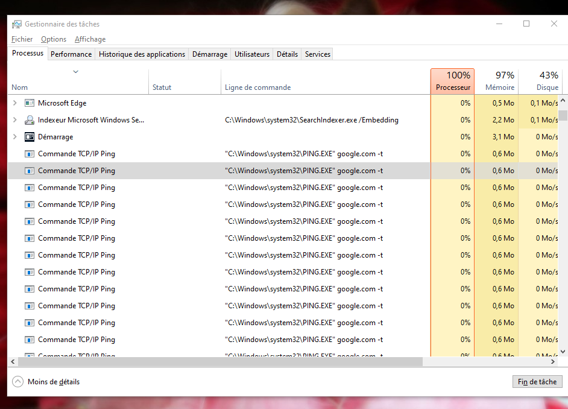

Ils lancent tous `ping google.com -t`. Le `-t` fait tourner le ping en continu, alors que sans lui il s'arrête après quatre paquets, donc aucun de ces processus ne se termine et ils s'empilent.

### Trouver ce qui les lance

Tuer les processus ne sert à rien tant que ce qui les crée tourne encore, donc je suis allé voir l'onglet Démarrage.

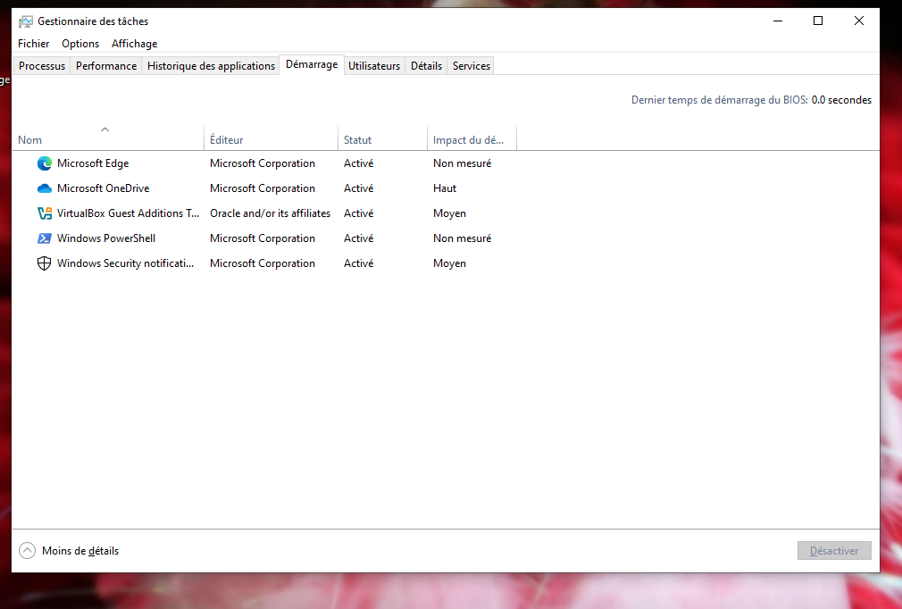

À côté d'entrées normales comme Edge, OneDrive ou les Guest Additions, il y a une entrée Windows PowerShell. Windows ne lance pas PowerShell à l'ouverture de session, donc elle a été ajoutée.

Elle vient du dossier de démarrage de l'utilisateur, qu'on ouvre en tapant `shell:startup` dans la barre d'adresse de l'explorateur. Il contient un raccourci nommé Ping, et voici sa cible :

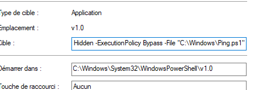

Il y a trois choses à regarder dedans. `-WindowStyle Hidden` fait en sorte qu'aucune fenêtre n'apparaisse à l'écran. `-ExecutionPolicy Bypass` contourne la politique d'exécution de PowerShell, qui refuserait sinon de lancer un script non signé. Et `-File` pointe vers un script rangé dans `C:\Windows`, un dossier où personne ne va regarder.

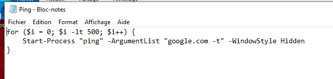

```powershell
for ($i = 0; $i -lt 500; $i++) {
    Start-Process "ping" -ArgumentList "google.com -t" -WindowStyle Hidden
}
```

500 ping en continu, relancés à chaque ouverture de session.

### Nettoyage

J'ai supprimé le raccourci dans le dossier de démarrage puis le script dans `C:\Windows`, et j'ai redémarré pour que les processus déjà lancés partent avec la session.

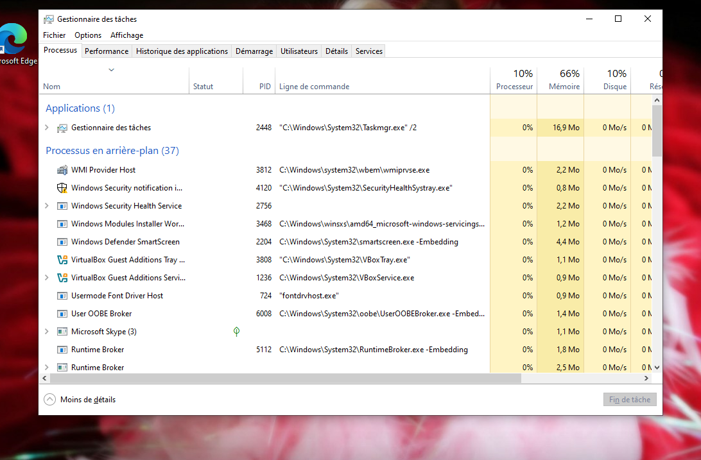

On passe de plus de 500 processus en arrière-plan à 37, de 100 % de processeur à 10 %, et de 90 % de mémoire à 66 %.

---

## Les disques

L'utilisatrice s'inquiétait de l'état de ses disques, donc j'ai ouvert la gestion des disques.

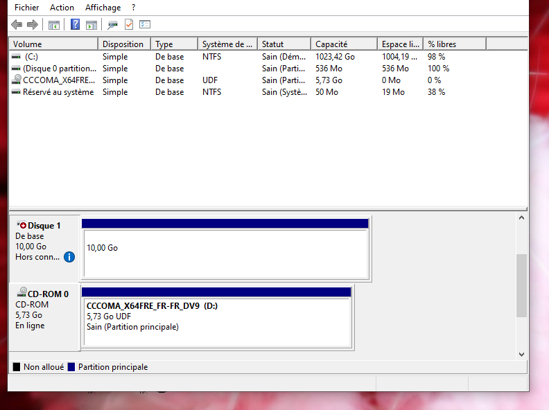

Le disque 1 est hors connexion, avec comme motif « stratégie définie par un administrateur ». Ce n'est pas une panne, c'est un attribut posé sur le disque.

```
diskpart
select disk 1
attributes disk
```

La sortie montre deux choses différentes : le disque est hors connexion, et il est aussi en lecture seule. Si je le remets simplement en ligne sans toucher au second attribut, il remonte mais reste inutilisable.

```
attributes disk clear readonly
online disk
```

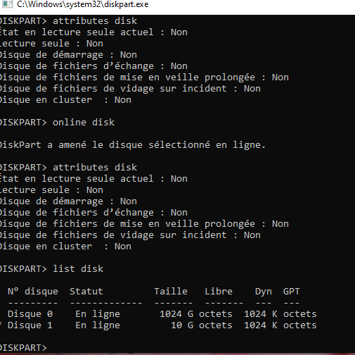

Ensuite j'ai lancé `chkdsk` pour répondre à la question posée au départ.

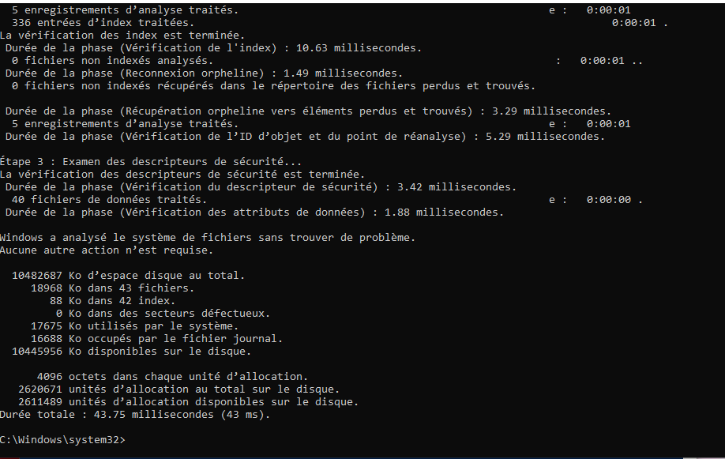

Rien à signaler sur le système de fichiers, et zéro secteur défectueux. Sur le disque système, un scan en lecture seule n'a rien relevé non plus. Les disques vont bien, c'est un attribut logiciel qui rendait le second invisible.

---

## Les fichiers disparus

Un fichier texte laissé dans le dossier Images explique qu'un dossier nommé `York`, qui contenait des photos, a été supprimé.

Après la remise en ligne du disque 1, un dossier `York` réapparaît. Sauf que le chemin complet est celui-ci :

```
E:\FileHistory\Mme Michu\DESKTOP-8DF7QI8\Data\C\Users\Mme Michu\Pictures\York
```

`FileHistory` est le dossier de l'Historique des fichiers de Windows, donc le disque 1 n'est pas un disque de données mais le disque de sauvegarde de la machine. Ce que je regardais était une copie versionnée et pas le dossier d'origine, ce que confirment les horodatages ajoutés aux noms de fichiers.

Je pouvais copier les fichiers à la main, mais je me serais retrouvé avec ces noms horodatés. Je suis donc passé par l'interface prévue pour ça, qui restaure à l'emplacement d'origine avec les vrais noms : Panneau de configuration, Historique des fichiers, Restaurer des fichiers personnels.

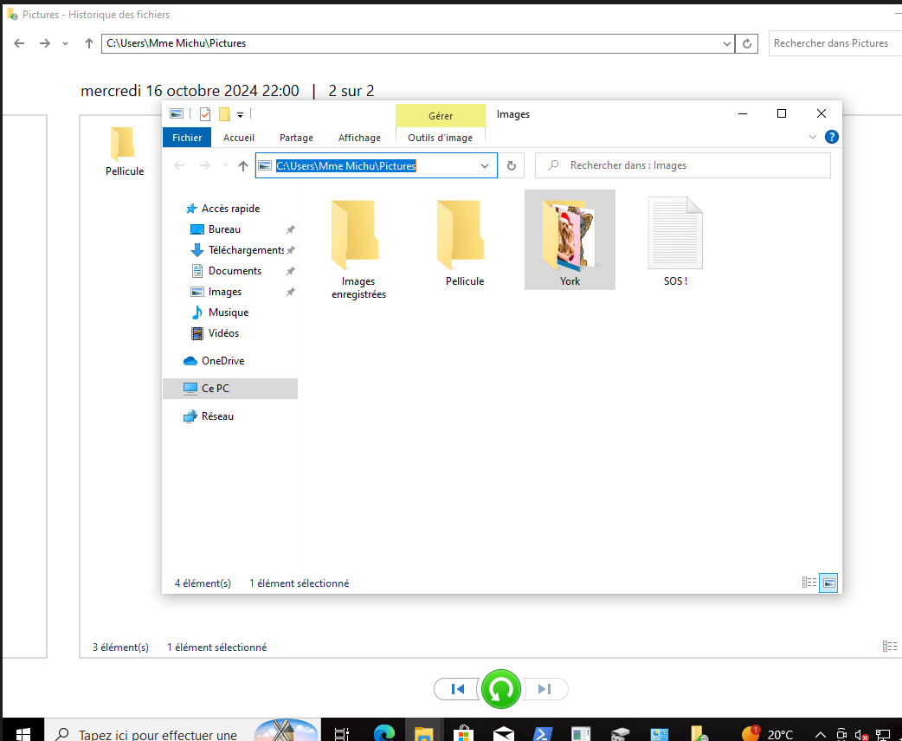

La sauvegarde contient aussi le script `Ping.ps1`, donc il ne faut pas tout restaurer en bloc sous peine de remettre le problème précédent en place. Je l'ai supprimé de la sauvegarde au passage.

---

Aucun des quatre problèmes n'était matériel, alors que trois d'entre eux en donnaient l'impression. Les deux derniers avaient même la même cause : le disque mis hors ligne était le disque de sauvegarde, donc tant qu'il restait invisible la restauration était impossible. Ce qui ressemblait à quatre pannes indépendantes était une suppression accidentelle suivie de tentatives de réparation qui ont empilé les symptômes.
